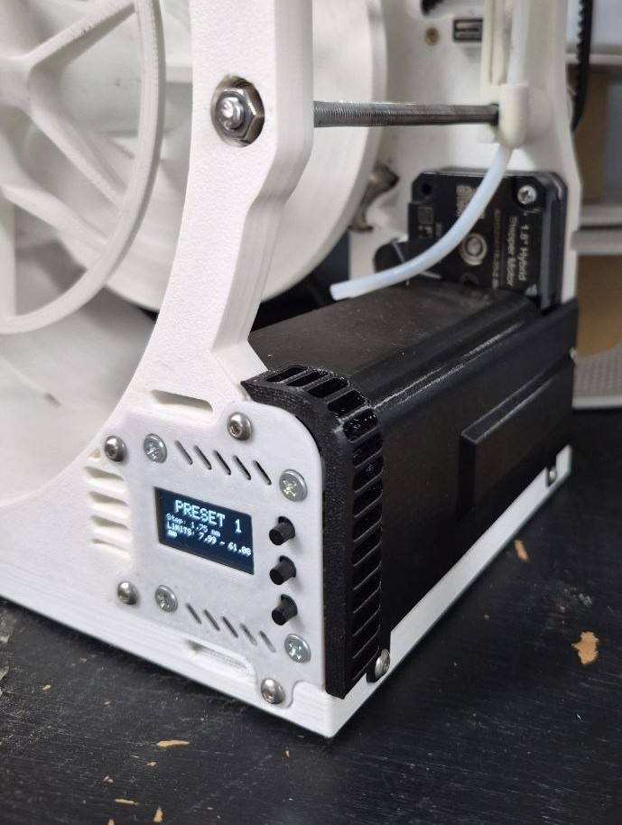
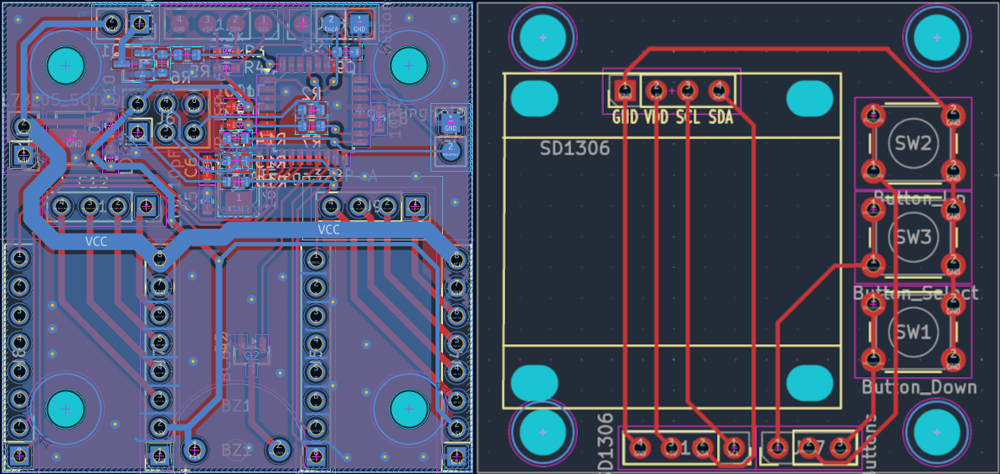

# Respooler

A control board for an automatic filament respooler. Based on the **ATmega328P**, it drives two stepper motors, provides a simple user interface, and monitors filament feed from the donor spool.

## Photos

The assembled device in its enclosure.

The main board and display board as shown in KiCad.

## Features

- Two stepper motors: one rotates the receiving spool, while the other moves the filament guide to distribute filament evenly.
- Operation through a display and three buttons.
- Presets for different spool sizes and filament diameters.
- Estimates the wound filament length and weight based on the number of turns and configured parameters.
- An encoder monitors the donor spool. Winding stops if the spool stops turning, indicating that filament feed has ended.
- A buzzer signals when winding is complete.

The weight is an estimate calculated by the controller; it is not measured with a load cell.

## Hardware

This repository contains KiCad projects for the main controller board and a separate display board:

- `PCB/RespoolerPCB.kicad_pro` — main ATmega328P controller board.
- `PCB/DisplayPCB/DisplayShield/DisplayShield.kicad_pro` — display and button board.
- `PCB/Pictures/` — photos of the assembled device and board render.

The main board provides connections for two stepper drivers, an encoder, end stops, the display, buttons, a fan, and ISP programming. The display board is designed for an I²C SSD1306 OLED and has three control buttons.

## Project files

Open the relevant `.kicad_pro` file in KiCad to view the schematic and PCB layout. The local OLED footprint library is in `PCB/SSD1306.pretty/`.

> This repository currently contains the KiCad hardware design. Firmware and a separate assembly guide are not included.
